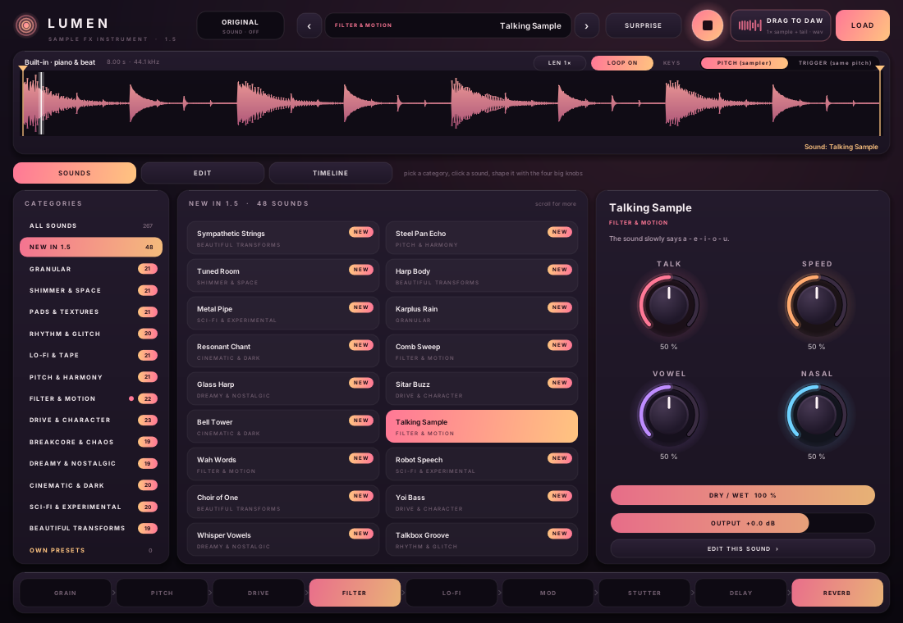
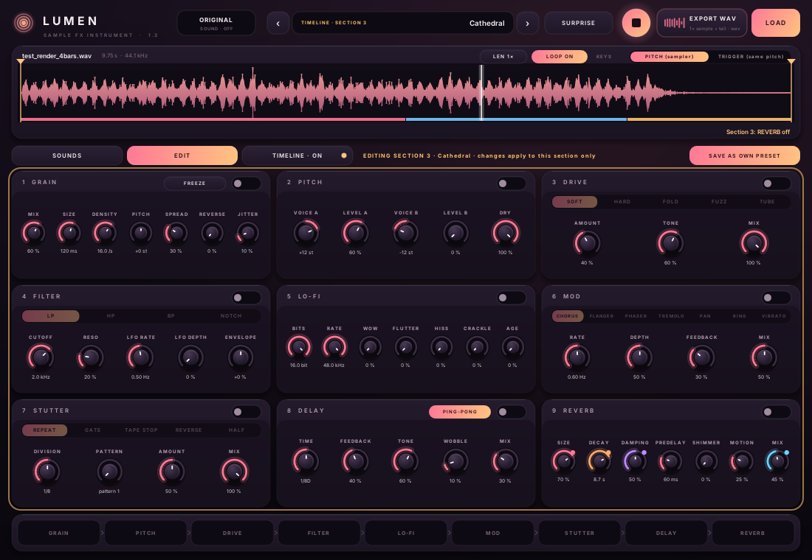
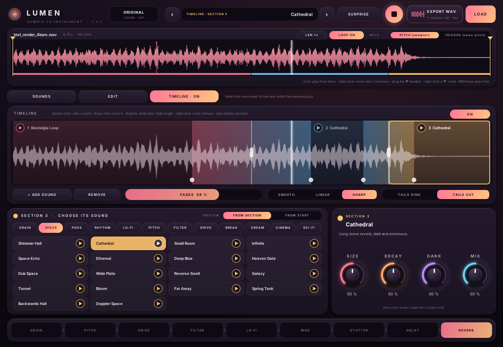

# Lumen

**A sample effect instrument for FL Studio and other DAWs (VST3 + CLAP, Windows 64-bit).**
Load one sound, pick one of **204 hand-built effect sounds** in 12 categories, shape it with four big knobs, and drag the result straight into your project.



> **Vibecoded, openly.** Lumen was written entirely by [Claude](https://claude.ai) (Anthropic's AI) in conversation.
> I described what I wanted, tried every build in FL Studio and said what to change; Claude wrote the DSP, the UI, the
> 204 sound recipes, the tests, the installer and the manual. Use it, read it, fork it.

## Download

Get **Lumen-1.2.1-Windows-Setup.exe** from [Releases](../../releases). The installer puts
`Lumen.vst3` in `C:\Program Files\Common Files\VST3` and `Lumen.clap` in `C:\Program Files\Common Files\CLAP`, plus the manual.
In FL Studio: *Options → Manage plugins → Find installed plugins*; Lumen is listed with the instruments.
The installer isn't code-signed, so SmartScreen may warn: *More info → Run anyway*.
Installing over an older version is fine, and projects keep their sounds.

## What it does

- **204 effect sounds in 12 categories**, level-matched, each with 4 macro knobs:
  Granular · Shimmer & Space · Pads & Textures · Rhythm & Glitch · Lo-Fi & Tape · Pitch & Harmony · Filter & Motion ·
  Drive & Character · Breakcore & Chaos · Dreamy & Nostalgic · Cinematic & Dark · Sci-Fi & Experimental.
  For example *Break Scramble* (the beat cut into 1/16 slices and shuffled), *Polaroid* (a frozen snapshot fading in and out),
  *Shoegaze Wall*, *Doppler Space*, *Out of Tune Piano*, *Event Horizon*, *Silent Film*, *Trailer Boom*.
- **EDIT page**: every sound is built from 9 modules — GRAIN → PITCH → DRIVE → FILTER → LO-FI → MOD → STUTTER → DELAY → REVERB — all editable.
- **TIMELINE page**: fade between up to 6 sounds over the length of the sample, with fade length, curve, tails and preview buttons.
- **Playback**: loop or one-shot; click the waveform to play from there, right-click to move start/end; MIDI keys transpose or retrigger.
- **ORIGINAL** for instant A/B, DRY/WET, output level, SURPRISE for a random sound.
- **EXPORT WAV / drag to DAW**: renders the sample plus its effect tail.
- Everything is automatable.




## Building

Requirements: `git`, a C++17 compiler, Python 3 with `reportlab` (manual), and for Windows builds from Linux
`g++-mingw-w64-x86-64-posix` and `nsis`. Linux builds need the X11/GL dev packages
(`libgl-dev libx11-dev libxcursor-dev libxext-dev libxrandr-dev`).

```bash
git clone https://github.com/qouinn/Lumen.git && cd Lumen
bash build.sh windows             # first run also fetches DPF + dr_libs (deps.sh) -> bin/windows/Lumen.vst3, Lumen.clap
bash installer/make_installer.sh  # -> dist/Lumen-1.2.1-Windows-Setup.exe
bash build.sh linux               # -> bin/linux (builds and passes the tests; not tried in a Linux DAW)
```

GitHub Actions builds the installer on every push and attaches it to the release when a `v*` tag is pushed.

## Tests

```bash
# engine: ORIGINAL is bit-exact, loop/keys, all 204 sounds stable with every macro at 0 and 1, level matching,
# a duplicate check (every sound is compared with every other by recipe and by a rendered fingerprint), timeline fades, CPU
g++ -std=gnu++17 -O2 -Iplugins/Shared -Iplugins/Lumen -Idpf/distrho plugins/Lumen/tests/test_lumen.cpp plugins/Shared/Export.cpp -o build/test_lumen
build/test_lumen build/out

# the real plugin binary in a minimal CLAP host, including clicks on the UI (needs xvfb + xdotool)
g++ -std=gnu++17 -O2 -Idpf/distrho/src plugins/Lumen/tests/lumen_host_test.cpp -ldl -lX11 -o build/lumen_host_test
xvfb-run -s "-screen 0 1300x900x24" build/lumen_host_test bin/linux/Lumen.clap some.wav build/out/lu

# the Windows build under Wine
x86_64-w64-mingw32-g++ -std=gnu++17 -O2 -Idpf/distrho/src plugins/Lumen/tests/clap_gui_win.cpp -static -lole32 -lshell32 -luuid -lgdi32 -o build/test/clap_gui_win.exe
bash plugins/Lumen/tests/run_lumen_win_gui.sh 1 build/out
```

## Making sounds

Sounds are readable Python recipes in [`plugins/Lumen/tools/make_presets.py`](plugins/Lumen/tools/make_presets.py), for example:

```python
preset(C, 'Polaroid', 'A frozen snapshot fades in and out under the live sound, faded and dusty.',
       M(grn(0.5, 400, 16, 0, 0.4, 0.1, 0.1, 1), mod(3, 0.2, 0.75, 0, 1.0), lofi(15, 40000, 0.1, 0, 0.06, 0.35, 0.5), lp(7000, 0.1)),
       [('SNAPSHOT', [('g_mix', 0.0, 1.0)]), ('FADE', [('m_depth', 0.0, 1.0), ('m_rate', 0.05, 1.0)]),
        ('AGE', [('l_age', 0.0, 1.0), ('l_crackle', 0.0, 0.7)]), TONE])
```

`python3 plugins/Lumen/tools/make_presets.py` generates `LumenPresets.hpp`. New sounds are only ever **appended**, because projects store sounds by number.
To level-match after adding sounds: `build/test_lumen build/out plugins/Lumen/tools/trims.txt`, regenerate, and repeat 2–3 times.

## Layout

```
plugins/Lumen/      LumenDSP.hpp (player + 9 modules + timeline), LumenParams.hpp, LumenPlugin.cpp, LumenUI.cpp (NanoVG),
                    LumenPresetTypes.hpp (macro mapping), LumenPresets.hpp (generated), tools/, tests/
plugins/Shared/     sample loading, WAV export + drag and drop, fonts
installer/          NSIS script
docs/               manual generator + screenshots
dpf/                DISTRHO Plugin Framework (fetched by deps.sh)
```

## Licence

Lumen is ISC licensed (see [LICENSE](LICENSE)). It is built with [DPF](https://github.com/DISTRHO/DPF) (ISC), pugl (ISC), NanoVG (zlib),
the Inter typeface (SIL OFL) and [dr_libs](https://github.com/mackron/dr_libs) (public domain / MIT-0); see [THIRD-PARTY.txt](THIRD-PARTY.txt).
VST is a trademark of Steinberg Media Technologies GmbH.
